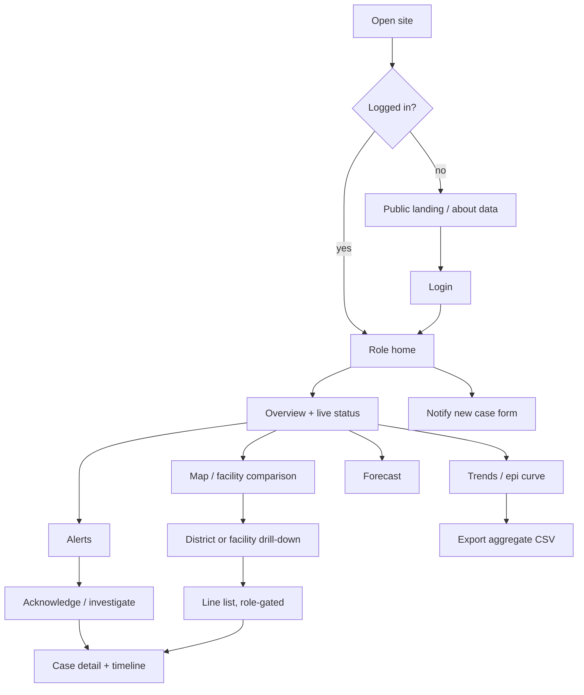
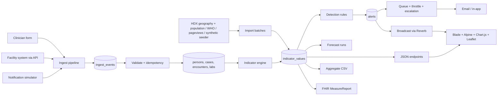
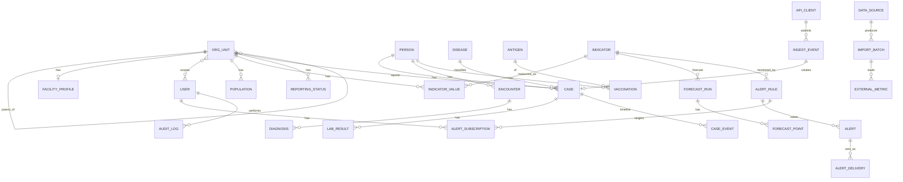

# District Outbreak Watch — Build Plan

A secure, mobile-friendly disease-surveillance system for a national unit, its district teams and the facilities that report to them.
Stack: Laravel, Alpine.js, AdminLTE 2.x (Bootstrap 3 + jQuery), Chart.js, Leaflet. Built and run locally first.
Source notes and items still to verify: `RESEARCH.md`.

---

## 1. Overview

**Problem:** disease counts, vaccination figures and reporting status arrive from different places and late, so outbreaks are noticed after they have grown.

**Solution:** one system that
1. receives notifications from facilities (form, API, imports) and routine aggregate data,
2. turns them into trusted indicators by facility, district and nation,
3. detects unusual signals, projects the next few weeks, and alerts the right people without flooding them,
4. lets clinicians and officers investigate individual (synthetic) cases under strict access rules,
5. exposes only aggregated data for export and public use.

| # | Decision the system supports | Who |
|---|---|---|
| D1 | Is any disease rising abnormally, and where? | district officer, national manager, epidemiologist |
| D2 | Which cases need investigation or follow-up now? | district officer, clinician |
| D3 | Which districts and facilities are below vaccination targets? | national manager |
| D4 | Are facilities reporting completely and on time? | national manager, district officer |
| D5 | What is likely to happen over the next few weeks? | epidemiologist, national manager |
| D6 | What is the public paying attention to? | national manager |

---

## 2. Scope

Built in layers. Each layer works without the ones above it.

| Layer | Contents |
|---|---|
| **Core** | Auth, roles and scoping, audit log; org structure with facility filter; aggregate pipeline from three or more sources with provenance; indicator engine; dashboards; alerts (tiers, cooldown, count floor, escalation, email); aggregate CSV; public pages; FHIR `MeasureReport`; ICD-10 coding |
| **Case-based** (EHR-lite, synthetic only) | Person, case, encounter, diagnosis, lab result, vaccination, case timeline; notification form; investigation workflow; line list; synthetic data generator that stays consistent with the aggregates |
| **Real-time** | Authenticated notification API (JSON and simplified FHIR Bundle), idempotent; ingest pipeline; live dashboard updates; notification simulator |
| **Forecasting** | 1–4 week projections with intervals, backtest scores and clear labelling |

**Not built:** native mobile app, real patient data, SNOMED CT, billing/pharmacy/imaging, full clinical records, self-registration, multi-language, machine-learning forecasting. Mobile use is covered by a responsive web app with an optional installable manifest.

**Data rules:** all patient-level data is synthetic and flagged `is_synthetic`; the UI shows a persistent "synthetic data" banner; there is no line-list export; CSV export is aggregates only.

---

## 3. Users and access

Roles say *what* a user can do; scope says *where* (which org units). Both are enforced on the server.

| Role | Purpose |
|---|---|
| `system_admin` | Users, org structure, data sources, alert rules, settings. No case-level access |
| `national_manager` | All aggregates, alert rules and escalation, forecasts, audit summary |
| `epidemiologist` | All aggregates and forecasts; pseudonymised case view (no exact date of birth); annotations |
| `district_officer` | Everything in assigned districts, including full case detail, investigation, alert acknowledgement |
| `clinician` | Own facility: notify cases, record encounters, labs and vaccinations; see own facility's indicators |
| `lab_officer` | Enter and view lab results for own lab's cases; no other case detail |
| *API client* | Submit notifications and receive acknowledgements; no read access |
| *Public visitor* | Landing and about-the-data pages only |

| Capability | admin | national | epi | district | clinician | lab |
|---|---|---|---|---|---|---|
| Aggregate dashboards | — | all | all | district | facility | — |
| Forecasts | — | all | all | district | — | — |
| Case list | — | — | pseudonymised, all | full, district | full, facility | limited, own lab |
| Create/edit case, encounter, vaccination | — | — | — | district | facility | — |
| Enter lab result | — | — | — | district | — | own lab |
| Acknowledge alerts | — | all | — | district | facility | — |
| Edit alert rules and escalation | yes | yes | — | — | — | — |
| Export aggregate CSV | — | all | all | district | facility | — |
| Annotate charts | — | yes | yes | yes | — | — |
| Manage users, org units, sources | yes | — | — | — | — | — |
| View audit log | yes | summary | — | — | — | — |

**Enforcement:** a global query scope on the org-unit subtree, policies on every case and export route, and tests proving that changing an ID in the URL never reveals out-of-scope data.

**Patient-level data handling** (applies even though the data is synthetic):
- no direct identifiers stored; pseudonymous ID, sex, birth year, residence at district level;
- every case view and change is written to the audit log;
- field-level visibility by role;
- notification payloads encrypted at rest;
- session timeout and re-authentication for case detail on shared devices;
- alert emails carry no case-level detail.

---

## 4. Functional modules

### 4.1 Authentication and access
Login with password manager and paste support; throttled attempts; session timeout; role and org-unit scope; user management for admins; audit log of logins, case views, exports and configuration changes.

### 4.2 Org structure and reference data
Country → region → district → facility hierarchy (4 regions and 135 districts with polygons, sentinel facilities with type); facility profiles; populations by year, age group and sex; disease list with ICD-10 codes and immediate-notifiable flag; antigen list; indicator definitions.

### 4.3 Data import and provenance
Import commands for the Uganda geography, population and facility files, the synthetic demo seeder, WHO reference data and web metrics; validation, rejection counts, idempotent re-runs; every dataset recorded with source, licence, access date and batch. The app never calls external APIs at runtime.

### 4.4 Indicator engine
Computes indicators per org unit, period and dimension from cases and imported aggregates; rolls values up the org tree; recomputes only what changed; records data-quality flags (missing, outlier, duplicate, coverage above 100%).

### 4.5 Dashboards
- **Overview:** headline numbers, live status, data last updated.
- **Trends:** weekly line by disease, epi curve by onset date, date and org-unit filters, tooltips.
- **Comparison and map:** district and facility comparison, choropleth map, drill-down to district and facility.
- **Quality:** u-chart with signal markers.
- **Vaccination:** coverage against target by antigen and area.
- **Reporting:** completeness and timeliness heatmap by facility and week.
- **Case-based views:** age-sex chart, classification and outcome, time to notification, lab confirmation.
- **Forecast:** projection with interval and backtest score.
- **Attention:** web-attention trend for each disease.
- Every chart has a text summary and a data table; bars start at zero; denominators are shown; counts below 5 are flagged.

### 4.6 Alerts
Rules by indicator, disease and area; methods: outbreak signal, single case of an immediate-notifiable disease, cluster, threshold; severity tiers; cooldown; minimum count; instant emails, daily digest, in-app notifications; acknowledge with note; escalation to the next role if unacknowledged; subscriptions by role and scope.

### 4.7 Case management (EHR-lite)
Notification form usable on a phone; person and case records; encounters with ICD-10 diagnoses; lab results; vaccination history; case timeline; classification and outcome workflow; investigation status; line list with filters; field-level visibility by role; synthetic banner.

### 4.8 Real-time ingestion
Token-authenticated `POST` endpoint (JSON and simplified FHIR Bundle) with idempotency keys; stored raw payloads; validation and rejection reasons; case creation; incremental indicator recompute; scoped detection; broadcast to open dashboards; a simulator that replays realistic notifications.

### 4.9 Forecasting
Moving-average and exponential-smoothing models; 1–4 week horizon; residual-based intervals truncated at zero; rolling-origin backtest compared with a naive baseline; method, horizon and score displayed with every projection.

### 4.10 Exports and interfaces
Aggregate CSV with a header listing source, filters and export time; FHIR `MeasureReport` JSON; notification API; shareable summary card (aggregate national numbers only).

### 4.11 Public site
Landing page, about-the-data and provenance pages, `sitemap.xml`, `robots.txt`, metadata and JSON-LD. Dashboard, API and export routes are `noindex` and disallowed.

---

## 5. Flows

### 5.1 User flow

### 5.2 Data flow

### 5.3 Real-time notification flow
1. A clinician submits the form, or a facility system POSTs a notification with an idempotency key.
2. The raw payload is stored encrypted in `ingest_events`, status `received`.
3. A queued job validates, rejects or accepts, and creates or updates the person and case.
4. The indicator engine marks affected (org unit, indicator, week) values stale and recomputes them up the org tree.
5. Detection runs for the affected scope; a rule that fires creates an alert.
6. The server broadcasts an event; open dashboards in scope update.
7. Delivery rules decide instant, digest or escalation.

### 5.4 Alert flow
Signal computed → one alert per (rule, org unit, disease, period) → suppressed inside the cooldown or below the count floor → severity decides instant or digest → recipients are users with matching role and scope → if unacknowledged after the rule's escalation time, escalate to the next role up → acknowledgement closes the cooldown early.

### 5.5 Request lifecycle and exposure points
DNS lookup → TCP → TLS handshake → HTTP request → Laravel middleware (HTTPS, auth, scope) → JSON → browser render. Exposure if unprotected: DNS (which site is visited), plain HTTP (credentials and counts in clear), downgrade without HSTS, server logs (IPs, URLs), WebSocket channels (live data leaks if channels are public), API tokens in transit, browser cache on shared devices, third-party fonts or tiles (user IP shared), email in transit and at rest.

---

## 6. Indicators

| ID | Indicator | Definition | Notes |
|---|---|---|---|
| I-01 | Cases | Cases per disease, org unit and ISO week, by classification | Derived or imported; `origin` recorded |
| I-02 | Incidence | cases / population × 100,000 | Denominator always shown |
| I-03 | Week-on-week change | (cases_t − cases_t−1) / cases_t−1 | "n/a" when previous week is 0 |
| I-04 | Case fatality | deaths / confirmed cases | Flag if denominator below 5 |
| I-05 | Time to notification | median days from onset to notification | Case-based only |
| I-06 | Lab confirmation rate | confirmed by lab / suspected | Case-based only |
| I-07 | Vaccination coverage | vaccinated / target population × 100 | Above 100% flagged as a data-quality issue |
| I-08 | Reporting completeness and timeliness | reports received (on time) / expected, by facility and week | |
| I-09 | Outbreak signal | cases_t > baseline mean + 3·√mean; baseline = 8 weeks ending 2 weeks before t; cases_t ≥ 5 | Parameters in `alert_rules`; tuned by backtest |
| I-10 | Immediate-notifiable trigger | one confirmed case of a flagged disease | e.g. cholera |
| I-11 | u-chart | u_i = c_i/n_i; centre ū = Σc/Σn; limits ū ± 3√(ū/n_i); 52-week baseline | Display only |
| I-12 | Projection | 1–4 week forecast with interval | Method and backtest score shown |
| I-13 | Attention index | weekly page views / mean of previous 8 weeks | Global, not local |

---

## 7. Data model

About 33 tables in seven groups. Indicators are data, not hard-coded tables, so adding one needs no migration.

### 7.1 Reference and structure
| Model | Key fields | Relationships |
|---|---|---|
| `OrgUnit` | `parent_id`, level, type (country/region/district/facility), name, code, `path`, geometry (nullable), lat, lng, active | belongsTo parent; hasMany children; hasOne `FacilityProfile`; belongsToMany `User` (scope); hasMany `Population`, `IndicatorValue`, `Case` |
| `FacilityProfile` | `org_unit_id`, facility_type, ownership, services (JSON) | belongsTo `OrgUnit` |
| `Population` | `org_unit_id`, year, age_group, sex, value, `data_source_id` | belongsTo `OrgUnit`, `DataSource` |
| `Disease` | name, `icd10_code`, priority, case_definition, immediate_notifiable | hasMany `Case`, `AlertRule`, `Indicator`, `ExternalMetric` |
| `Antigen` | name, code, doses_required | hasMany `Vaccination` |
| `Indicator` | code, name, kind, numerator and denominator definitions, unit, direction, target, small_number_floor, `disease_id` | belongsTo `Disease`; hasMany `IndicatorValue`, `AlertRule`, `ForecastRun` |

### 7.2 Case-based layer (synthetic)
| Model | Key fields | Relationships |
|---|---|---|
| `Person` | pseudonymous_id, sex, birth_year, residence `org_unit_id`, `is_synthetic` | hasMany `Case`, `Encounter`, `Vaccination`; no direct identifiers |
| `Case` | `person_id`, `disease_id`, reporting and residence `org_unit_id`, onset_date, notification_date, investigation_date, classification, outcome, hospitalised, icd10_code, status, epi_week, `ingest_event_id`, `is_synthetic` | belongsTo `Person`, `Disease`, `OrgUnit` ×2, `IngestEvent`; hasMany `LabResult`, `CaseEvent`, `Encounter` |
| `Encounter` | `person_id`, `case_id` (nullable), facility `org_unit_id`, encountered_at, type | belongsTo `Person`, `Case`, `OrgUnit`; hasMany `Diagnosis` |
| `Diagnosis` | `encounter_id`, icd10_code, is_primary | belongsTo `Encounter` |
| `LabResult` | `case_id`, specimen_type, test_code, collected_at, resulted_at, result, lab `org_unit_id` | belongsTo `Case`, `OrgUnit` |
| `Vaccination` | `person_id`, `antigen_id`, dose_number, administered_on, facility `org_unit_id` | belongsTo `Person`, `Antigen`, `OrgUnit` |
| `CaseEvent` | `case_id`, type, data (JSON), `user_id`, occurred_at | belongsTo `Case`, `User` (timeline) |

### 7.3 Aggregates, quality and analytics
| Model | Key fields | Relationships |
|---|---|---|
| `IndicatorValue` | `org_unit_id`, `indicator_id`, period_type, period_start, age_group, sex, numerator, denominator, value, origin (derived/imported), stale, computed_at | belongsTo `OrgUnit`, `Indicator`; unique on the dimension key; rolled up the org tree |
| `ReportingStatus` | facility `org_unit_id`, period_start, expected, received, on_time | belongsTo `OrgUnit` |
| `ExternalMetric` | `disease_id`, source, metric, period_start, value, geography_scope | belongsTo `Disease`, `ImportBatch` |
| `ForecastRun` | `indicator_id`, `org_unit_id`, method, params (JSON), trained_through, horizon_weeks, backtest (JSON) | belongsTo `Indicator`, `OrgUnit`; hasMany `ForecastPoint` |
| `ForecastPoint` | `forecast_run_id`, period_start, point, lower, upper | belongsTo `ForecastRun` |
| `DataQualityFlag` | `org_unit_id`, `indicator_id`, period_start, type, severity, resolved_at | belongsTo `OrgUnit`, `Indicator` |
| `Annotation` | `user_id`, `org_unit_id`, `indicator_id`, period_start, text | belongsTo `User`, `OrgUnit`, `Indicator` |

### 7.4 Ingestion and provenance
| Model | Key fields | Relationships |
|---|---|---|
| `DataSource` | name, url, licence, terms_note, accessed_at, citation | hasMany `ImportBatch`, `Population` |
| `ImportBatch` | `data_source_id`, started_at, finished_at, rows_in, rows_rejected, status | belongsTo `DataSource`; hasMany `ExternalMetric` |
| `IngestEvent` | `api_client_id` (nullable), channel, idempotency_key (unique), payload (encrypted), payload_hash, status, error, received_at, processed_at | belongsTo `ApiClient`; hasOne `Case` |
| `ApiClient` | name, `org_unit_id`, active, last_seen_at | belongsTo `OrgUnit`; hasMany `IngestEvent`; tokens via Sanctum |

### 7.5 Alerting
| Model | Key fields | Relationships |
|---|---|---|
| `AlertRule` | `indicator_id` or `disease_id`, scope `org_unit_id`, method (outbreak_signal / single_case / cluster / threshold), params (JSON), severity, cooldown_hours, min_count, escalate_after_minutes, audience_roles (JSON), enabled | belongsTo `Indicator`, `Disease`, `OrgUnit`; hasMany `Alert`, `AlertSubscription` |
| `Alert` | `alert_rule_id`, `org_unit_id`, `disease_id`, period_start, observed, expected, upper_limit, severity, status, triggered_at, `acknowledged_by`, acknowledged_at, escalated_at, note | belongsTo `AlertRule`, `OrgUnit`, `Disease`, `User`; hasMany `AlertDelivery` |
| `AlertSubscription` | `user_id`, `alert_rule_id` (nullable), `org_unit_id`, mode (instant/digest) | belongsTo `User`, `AlertRule`, `OrgUnit` |
| `AlertDelivery` | `alert_id`, `user_id`, channel, mode, sent_at, status, error | belongsTo `Alert`, `User` |

In-app notifications reuse Laravel's `notifications` table.

### 7.6 Access and governance
| Model | Key fields | Relationships |
|---|---|---|
| `User` | name, email, password, active, last_login_at | belongsToMany `OrgUnit` (scope); spatie roles and permissions; hasMany `AuditLog`, `Annotation`, `SavedView`, `AlertSubscription` |
| `AuditLog` | `user_id`, category (auth/data_access/export/config), action, subject_type, subject_id, ip, meta | belongsTo `User` |
| `SavedView` | `user_id`, name, route, filters (JSON) | belongsTo `User` |

Plus spatie `roles`, `permissions` and pivots, and Sanctum `personal_access_tokens`.

### 7.7 Services (not tables)
`IndicatorEngine`, `OutbreakDetector`, `ControlChartService`, `Forecaster`, `CaseIngestService`, `SyntheticCaseGenerator`, `AggregateQuery` (applies scope), `FhirMeasureReportBuilder`, `CsvExporter`, `AlertDispatcher`.

### 7.8 Feature-to-model check
| Feature | Models used |
|---|---|
| Facility and district filter, map, drill-down | `OrgUnit`, `IndicatorValue` |
| Role plus scope access | spatie roles, `User`↔`OrgUnit`, policies, `AuditLog` |
| Trend, comparison, u-chart, coverage, epi curve | `IndicatorValue`, `Indicator`, `Population` |
| Age-sex view, classification, line list | `Person`, `Case`, `LabResult`, `Vaccination` |
| Notification and investigation | `Case`, `Encounter`, `Diagnosis`, `CaseEvent` |
| Live ingestion and idempotency | `ApiClient`, `IngestEvent`, `Case` |
| Alerts, cooldown, escalation, digest | `AlertRule`, `Alert`, `AlertSubscription`, `AlertDelivery` |
| Forecasts and backtests | `ForecastRun`, `ForecastPoint` |
| Multiple sources and provenance | `DataSource`, `ImportBatch`, `ExternalMetric`, `IndicatorValue.origin` |
| Small numbers and data quality | `Indicator.small_number_floor`, `DataQualityFlag` |
| Reporting completeness | `ReportingStatus` |
| Annotations and saved filters | `Annotation`, `SavedView` |
| ICD-10 and FHIR | `Disease.icd10_code`, `Diagnosis.icd10_code`, `FhirMeasureReportBuilder` |

---

## 8. Outputs

| Output | Audience | Notes |
|---|---|---|
| Role home and overview | all logged-in roles | live status, data last updated, headline numbers |
| Trend line, epi curve, district/facility comparison, choropleth map, u-chart, coverage vs target, reporting heatmap, age-sex chart, attention trend, forecast | by role and scope | each with a data table and text summary |
| Line list and case detail with timeline | `district_officer`, `clinician`, `lab_officer` (limited), `epidemiologist` (pseudonymised) | synthetic banner; all views audited; no export |
| Notification form | `clinician` | works on a phone; validates ICD-10 and dates |
| Alert list, detail, acknowledge, escalate | per role | expected vs observed, rule and tier shown |
| Email: instant, digest, escalation | subscribers | minimal content |
| In-app notifications and live updates | logged-in users | Reverb, polling fallback |
| Aggregate CSV | by role and scope | header lists source, filters and export time |
| FHIR `MeasureReport` JSON | systems | `/api/fhir/MeasureReport?...` |
| Notification API response | facility systems | token-based, idempotent acknowledgement |
| Public pages, sitemap, robots, JSON-LD | public, search engines | private routes excluded |
| Provenance page | everyone | datasets, licences, access dates, batch IDs |
| Audit log screens | `system_admin` (full), `national_manager` (summary) | |
| Shareable summary card | public | aggregate national numbers only |

---

## 9. Technical approach

### 9.1 Key decisions
| Area | Decision |
|---|---|
| Primary data | Open Uganda data (see `DATA.md`): HDX COD-AB boundaries (4 regions, 135 districts), UBOS/UNFPA district population by age and sex, OSM-based Healthsites facility locations, WHO GHO immunization estimates for Uganda, Wikipedia page views. Open weekly facility-level disease and district immunization series do not exist, so weekly facility disease reports and district immunization doses are synthetic (`origin = synthetic`), calibrated to real populations and WHO national coverage, with realistic seasonality and outbreak scenarios, generated by `php artisan surveillance:seed-demo` |
| Reference and web data | WHO GHO (MCV1 coverage), WHO provisional measles, Wikipedia page views; all imported, never called at runtime |
| Patient-level data | Synthetic cases expanded from the synthetic weekly facility reports by `SyntheticCaseGenerator` for the case-reported diseases (measles, cholera, typhoid, Ebola); malaria stays aggregate-only. Totals always equal the aggregates; Synthea not used |
| Outbreak signal | count > baseline mean + 3·√mean, 8-week baseline, 2-week guard, minimum 5; single-case rule for immediate-notifiable diseases; tuned by backtest |
| Forecasting | Moving average and exponential smoothing, 1–4 weeks, residual intervals truncated at zero |
| Real-time | Laravel Reverb with Echo, polling fallback |
| Standards | ICD-10 on diseases and diagnoses; FHIR `MeasureReport` (R4); simplified FHIR Bundle on the notification API; SNOMED CT omitted |
| Small numbers | Flag counts below 5 everywhere |
| Hosting | Apache + PHP-FPM on a small VM or container, with queue worker, scheduler and Reverb process |
| Runtime third parties | None: no CDNs, remote fonts, map tiles or analytics |

### 9.2 Front end on AdminLTE
AdminLTE 2 supplies the shell (header, sidebar, grid, boxes). Everything inside the content area is built here: Blade components with semantic HTML5, one original CSS3 file, and Alpine components plus small vanilla modules. Chart.js renders charts; Leaflet renders a choropleth from GeoJSON with no tile layer.

Hardening the shell:
| Issue in a stock setup | Fix |
|---|---|
| Heavy pages (jQuery, Bootstrap JS and many plugins everywhere) | Load plugins per page; drop DataTables, pdfmake, select2 and datepicker in favour of native date inputs, selects and a small sortable table; defer scripts; Chart.js only on chart pages, Leaflet only on the map page |
| Old libraries with published advisories (jQuery before 3.5.0, Bootstrap 3 before 3.4.1) | Bootstrap 3.4.1 and a current jQuery; scan with `retire.js` or `npm audit` |
| Remote fonts and CDNs | Self-host everything |
| Full Font Awesome 4 font | Subset the icons used or use inline SVG |
| Fixed header can hide focused elements | Scroll padding; focus tests |
| Low contrast and weak focus rings | Override design tokens; verify contrast |
| Menu and widgets built on `div`s and jQuery handlers | Landmarks, `aria-expanded`, `aria-current`, keyboard handling |
| Canvas charts invisible to screen readers | `figure` with `figcaption`, text summary, data table for every chart |
| Colour alone encodes series | Marker shapes, line styles or patterns, direct labels, colour-blind-safe palette |
| Alpine's standard build needs `unsafe-eval` under a strict CSP | Use the Alpine CSP build with `Alpine.data` components where compatible |
| Small touch targets | At least 24×24 CSS px, larger on mobile |
| Poor phone layout | Mobile-first CSS Grid inside the shell; collapsing sidebar; reflowing charts; single-column forms |

If measurements show the shell cannot meet the quality requirements below, keep the same Blade components and CSS and swap in a small custom layout.

### 9.3 Chart.js
Use Chart.js 4. Check which version your AdminLTE copy ships; your reference project vendors a separate Chart.js build.

---

## 10. Quality requirements

| Requirement | Target |
|---|---|
| Responsive | Laptop, tablet and phone layouts all usable; forms and charts work by touch |
| Accessibility | WCAG 2.2 AA, including focus not obscured, target size, accessible authentication, colour-blind-safe colours, keyboard-only operation |
| Performance | Lighthouse performance 85 or above on mobile for the public page and the logged-in dashboard; usable on a throttled slow connection |
| Transport security | HTTPS only; HSTS set in the Apache vhost; strict CSP and security headers |
| Browsers | Chrome, Firefox and Edge or Safari |
| Honest data | Zero-based bars, denominators shown, small numbers flagged, units on every axis, forecasts labelled as projections |
| Privacy | No line-list export; case views audited; no third-party requests at runtime; `Cache-Control: no-store` on authenticated pages |
| Correctness tests | Role and scope isolation, aggregate-only export, ingestion idempotency, alert cooldown and escalation, indicator calculations, audit on every case view |

---

## 11. Implementation phases (by dependency, no dates)

### Phase 0: Data discovery
- Evaluate candidate open datasets (DHIS2 Sierra Leone demo, then Uganda open data on HDX); inspect what each really contains.
- Choose the data source, fix the disease list, check that district codes match across boundary and population files; record each source's licence in `DATA.md`.
- **Done when:** the indicator list is confirmed against real data.

### Phase 1: Requirements
- Stakeholder conversation (real or simulated); 8–12 user stories covering all roles; indicator sheet from section 6; request-lifecycle diagram from section 5.5.
- **Done when:** stories, indicator sheet and diagram are in `docs/`.

### Phase 2: Foundation
- Laravel scaffold, `git init`, first commit, written commit convention (short subject, body explaining why, one logical change per commit).
- spatie permissions, users with org-unit scope, audit log.
- AdminLTE shell brought in and hardened per section 9.2; semantic Blade layout with landmarks and accessible navigation; design tokens.
- Login with paste and password-manager support, throttling and session timeout.
- **Done when:** each role logs in and sees only its scope; the layout passes an accessibility scan; a test proves a user cannot open out-of-scope data by changing the URL.

### Phase 3: Structure and aggregate pipeline
- Migrations and models for 7.1, 7.3 (without forecasts) and 7.4; seeders for org units, diseases, indicators and roles.
- Import commands with validation and idempotency; `IndicatorEngine` with roll-up; data-quality flags.
- **Done when:** indicators exist for facility, district and nation from real data, and re-running an import changes nothing.

### Phase 4: Core dashboard
- Wireframe, then a clickable prototype, then a first round of testing with at least five users; adjust the layout before building screens (repeat wireframe-first for case forms and the line list).
- Overview, trends, comparison, choropleth map with drill-down, u-chart, vaccination coverage, reporting completeness, attention trend; filters, tooltips, aggregate CSV; accessible-chart pattern; honest-chart rules; small-number flags.
- **Done when:** six or more charts work on laptop, tablet and phone and pass keyboard and contrast checks.

### Phase 5: Alerts
- `AlertRule`, detection, `Alert`, subscriptions, deliveries; tiers, cooldown, minimum count, digest, escalation; email through a local mail catcher; acknowledge in the UI.
- Backtest the outbreak rule on history; record the false-alarm rate and tune.
- **Done when:** a seeded outbreak raises one alert and one email, a repeat inside the cooldown is suppressed, and an unacknowledged alert escalates.

### Phase 6: Case-based module
- Models from 7.2; `SyntheticCaseGenerator`; notification form; line list; case detail with timeline; lab entry; field-level visibility; audit on every case view; synthetic banner.
- **Done when:** generated cases reproduce the aggregate totals; a district officer sees full detail and an epidemiologist sees pseudonymised detail; no route exports a line list.

### Phase 7: Real-time ingestion
- `ApiClient` tokens; `IngestEvent` pipeline; idempotency; incremental recompute; scoped detection; Reverb channels authorised per scope; simulator; polling fallback.
- **Done when:** a simulated notification appears on an open dashboard and may raise an alert within seconds; replaying the same key creates nothing new.

### Phase 8: Forecasting
- `Forecaster` with moving-average and exponential-smoothing models; intervals; rolling-origin backtest against a naive baseline; projection chart with uncertainty and score.
- **Done when:** every projection shows method, horizon, interval and backtest result, and weak models say so.

### Phase 9: Standards and public site
- FHIR `MeasureReport` endpoint; ICD-10 usage across diseases and diagnoses; simplified FHIR Bundle on the notification API; landing, about-the-data and provenance pages; sitemap, robots, metadata, JSON-LD; shareable summary card.
- **Done when:** the endpoint validates against the R4 schema and no private route is indexable.

### Phase 10: Hardening and quality
- Accessibility pass against WCAG 2.2 AA including chart alternatives and screen-reader spot checks.
- Performance work: per-page assets, deferred scripts, compression, long-lived caching with versioned filenames, slow-connection testing.
- Shared-device safety; security headers and CSP; library scan; full test suite; three-browser check.
- **Done when:** every target in section 10 is met and measured.

### Phase 11: Deployment
- VM or container with Apache and PHP-FPM, queue worker, scheduler and Reverb; domain; HTTPS redirect; HSTS in the vhost; SPF, DKIM and DMARC for alert email.
- Scheduled database backups with a tested restore; retained audit logs; monitoring; the site stays online after hand-over.
- **Done when:** the live site passes the transport-security and email checks and a restore from backup succeeds.

---

## 12. Phase 0 outcome (data discovery, done)
- The DHIS2 Sierra Leone demo was inspected first: its weekly IDSR disease values are random 0–5 integers for 31 sparse weeks, so it cannot show real dynamics. It was dropped.
- Uganda was chosen instead. Open data confirmed on HDX: COD-AB boundaries (4 regions, 135 districts; CC BY-IGO), COD-PS district population by age and sex (UBOS via UNFPA; CC BY-IGO; pcodes match the boundaries), Healthsites facilities (8,061 OSM-derived records; ODbL).
- No open weekly facility-level disease or district immunization series exists for Uganda, so those are synthetic and labelled so; populations, geography and national coverage are real.
- Disease set: malaria (B50–B54, aggregate only), measles (B05), cholera (A00), typhoid fever (A01.0), Ebola virus disease (A98.4, immediate-notifiable).
- WHO GHO API verified live (WUENIC MCV1, DTP3, BCG); Wikipedia page views are fetched as a weekly snapshot.
- Facility types come from OSM tags and names, not Uganda's official health-centre levels; the mapping is a documented heuristic.
- Still unverified: WHO and Wikimedia reuse terms, and the full WHO case-field list.
